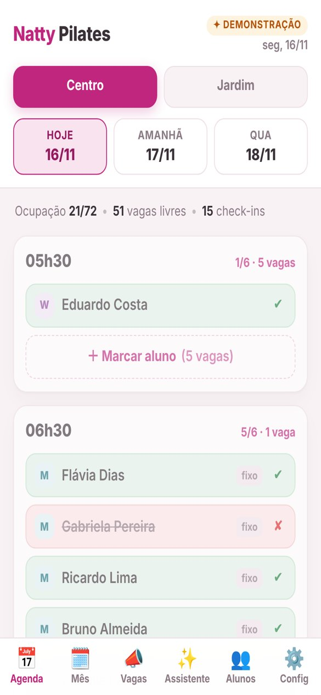
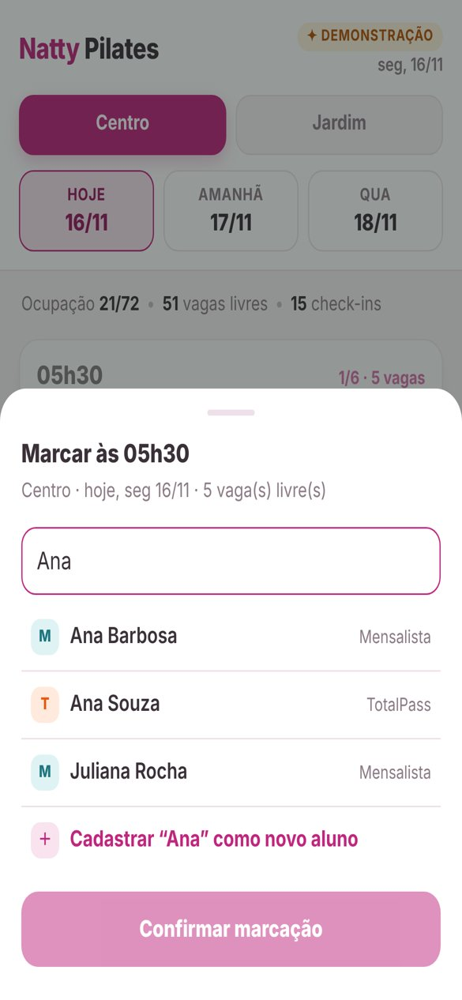
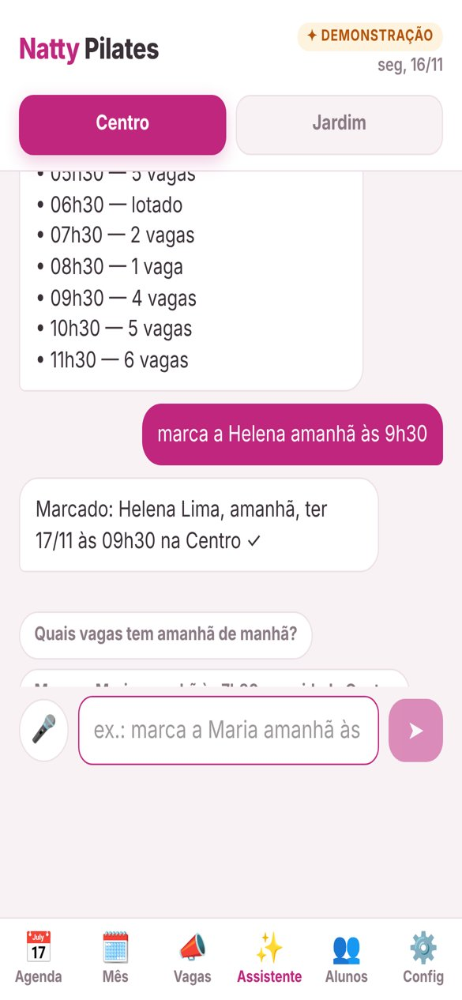
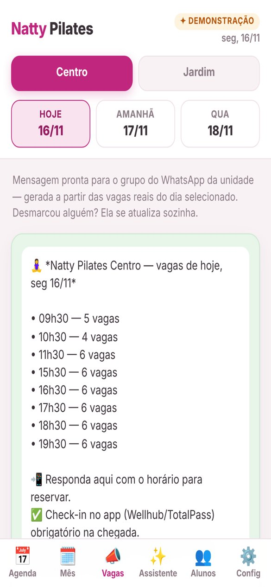
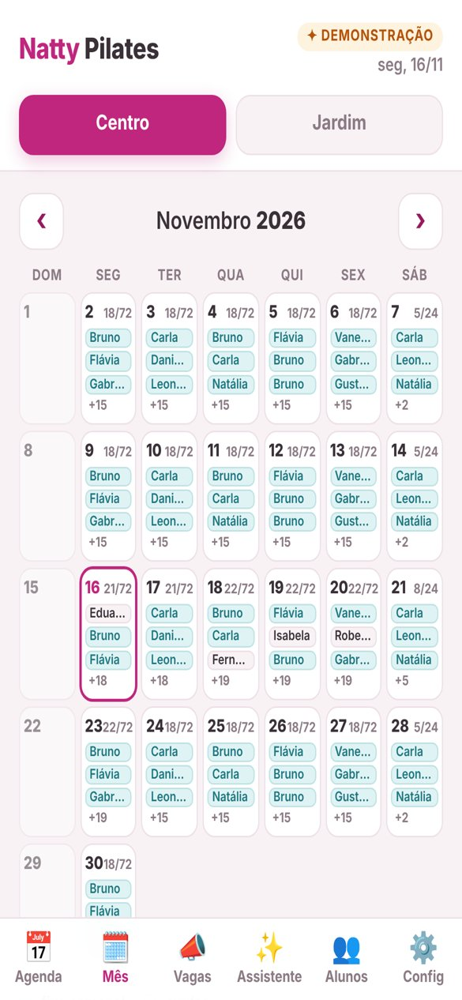
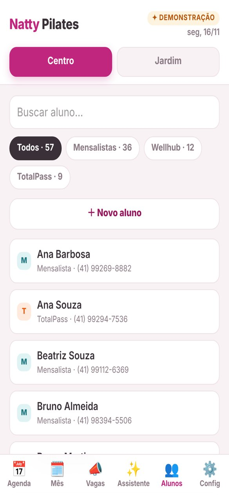

# Agenda Pilates 🧘‍♀️

**Agenda digital com assistente de IA para um estúdio de pilates — em produção e usada todos os dias pela equipe.**

O estúdio organizava as turmas numa agenda de papel e num vai-e-vem de mensagens no WhatsApp. Cada marcação, falta ou vaga liberada tomava tempo das professoras e gerava retrabalho. Este projeto troca isso por um app que roda no celular, atualiza em tempo real para toda a equipe e entende pedidos em linguagem natural, como *"marca a Maria amanhã às 7h30"*.

<p align="center">
  
  
  
</p>
<p align="center">
  
  
  
</p>
<p align="center"><sub>Telas do modo demonstração, com dados fictícios.</sub></p>

## O que o app faz

- **Agenda por unidade**, de hoje até 7 dias à frente, com carrossel de dias.
- **Marcação em dois toques**, com autocomplete; o cadastro do aluno nasce na hora.
- **Horário fixo semanal** para mensalistas e alunos de Wellhub e TotalPass.
- **Ausência que libera a vaga só naquele dia**, sem desfazer o horário fixo.
- **Check-in e falta**, e **encaixe** acima da capacidade quando a dona autoriza.
- **Mensagem de vagas pronta** para o grupo do WhatsApp, copiada com um toque.
- **Assistente de IA**: marca, desmarca e consulta vagas por texto ou voz.
- **Tempo real** entre os celulares da equipe e **PWA**, que instala como app.
- **Papéis**: dona (configura unidades, grade, equipe e uso da IA) e professoras (operam a agenda).

## Decisões de produto e engenharia

- **As regras moram no banco.** Capacidade, horários fixos, ausências e encaixes são garantidos por funções SQL e RLS no Postgres. Telas e rotas só chamam essas funções, então nenhuma regra fica duplicada nem pode ser contornada pela interface.
- **IA com custo sob controle.** O assistente usa a API do Claude com *tool use* sobre as mesmas funções da agenda. Cada resposta registra tokens e custo, existe um teto mensal configurável e, ao atingir o limite, o chat pausa sozinho. O custo fica na casa de centavos por mês.
- **Funciona sem IA e sem banco.** Sem chave da API, o assistente cai num parser local simples. Sem Supabase configurado, o app roda em modo demonstração, com dados em memória.
- **Uma interface única de dados** (`lib/repo.ts`) com duas implementações equivalentes, em memória e no Supabase, o que mantém o modo demonstração fiel à produção.
- **Custo de infraestrutura zero**, nos planos gratuitos do Supabase e da Vercel.

## Stack

Next.js 16 (App Router) · TypeScript · Supabase (Postgres, Auth, Realtime, RLS) · Claude API · Vercel · PWA

Construído em par com o [Claude Code](https://claude.com/claude-code).

## Rodar localmente (modo demonstração)

```bash
npm install
NEXT_PUBLIC_DEMO=1 npm run dev
# abra http://localhost:3000
```

Não precisa de nenhuma variável de ambiente: o app sobe com dados fictícios em memória. Para uma instância real, com Supabase, IA e deploy, veja [docs/instalacao.md](docs/instalacao.md), que também traz a estrutura de pastas e as regras garantidas pelo banco. O modelo de variáveis está em [`.env.example`](.env.example).

## Próximos passos

- Ficha completa do aluno, histórico de presença e relatório mensal de check-ins Wellhub e TotalPass.
- Portal do aluno com reserva self-service e regras de janela, limite diário e prazo de desmarcação.
- Lembretes individuais pela API oficial do WhatsApp.

---

Feito por [Guilherme Daflon](https://www.linkedin.com/in/gdaflonpro).
